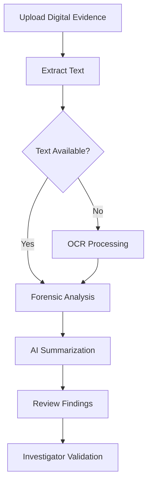

# 🕵️‍♀️ ForenAI
### AI-Powered Digital Evidence Analyzer

<p align="center">
  <strong>Turning Digital Evidence into Investigative Insights.</strong>
  <br />
  An AI-assisted platform for extracting, summarizing, and analyzing digital evidence.
</p>

<p align="center">
  
  
  
  
</p>

<p align="center">
  
  
</p>

---

## 🔍 Overview

**ForenAI** is an AI-assisted digital forensics project designed to help investigators examine digital evidence more efficiently.

The application combines document processing, Optical Character Recognition (OCR), and Natural Language Processing (NLP) to turn extracted evidence into structured information that can support an investigation.

The goal is to reduce manual effort during initial evidence review while keeping investigators responsible for validating findings and drawing conclusions.

## ✨ Features

<table>
  <tr>
    <td width="50%">
      <h3>📂 Evidence Upload</h3>
      Upload supported evidence files for processing.
    </td>
    <td width="50%">
      <h3>📄 OCR & Text Extraction</h3>
      Extract text from documents, images, and scanned PDFs using OCR where required.
    </td>
  </tr>
  <tr>
    <td width="50%">
      <h3>🤖 AI Summarization</h3>
      Generate concise summaries of extracted evidence using Hugging Face Transformers.
    </td>
    <td width="50%">
      <h3>🔎 Forensic Analysis</h3>
      Identify relevant identifiers, timestamps, and potentially significant findings.
    </td>
  </tr>
  <tr>
    <td width="50%">
      <h3>⚠️ Suspicious Keyword Detection</h3>
      Highlight potentially relevant terms for further investigator review.
      <br /><em>Status: In development / verify implementation.</em>
    </td>
    <td width="50%">
      <h3>🗓️ Timeline Generation</h3>
      Organize extracted timestamps into an investigative timeline.
      <br /><em>Status: In development / verify implementation.</em>
    </td>
  </tr>
  <tr>
    <td colspan="2">
      <h3>📊 Investigation Report Generation</h3>
      Work toward generating structured investigation reports from extracted evidence and analysis results.
      <br /><em>Status: In development / verify implementation.</em>
    </td>
  </tr>
</table>

## ⚙️ How It Works



*This diagram illustrates the intended workflow. Individual stages may have different implementation status in the current version.*

## 🧰 Tech Stack

| Category | Technologies |
|---|---|
| Programming Language | Python |
| User Interface | Streamlit |
| AI / NLP | Hugging Face Transformers |
| OCR Engine | Tesseract OCR, pytesseract |
| PDF Processing | PyPDF2, pdf2image |
| Word Documents | python-docx |
| Image Processing | Pillow |
| Version Control | Git, GitHub |
| Database | Not currently confirmed |

## 🚀 Getting Started

### Prerequisites

- Python 3.10 or a compatible version
- Git
- Tesseract OCR for image and scanned-document text extraction
- Poppler for PDF page rendering when using `pdf2image`

### Installation

**1. Clone the repository**

```bash
git clone https://github.com/prototype2006/ForenAI.git
cd ForenAI
```

**2. Create a virtual environment**

```bash
python -m venv .venv
```

Activate it on Windows:

```powershell
.\.venv\Scripts\Activate.ps1
```

**3. Install dependencies**

If the repository contains a `requirements.txt` file:

```bash
pip install -r requirements.txt
```

Otherwise, install the packages required by your current implementation and add them to `requirements.txt` so the environment can be recreated reliably.

**4. Launch the application**

```bash
streamlit run app.py
```

> **Note:** OCR setup paths and external dependencies may need configuration for your operating system.

## 🗺️ Roadmap

- [x] Evidence upload interface
- [x] Text extraction and OCR integration
- [x] AI summarization integration
- [x] Initial forensic analysis utilities
- [ ] Verify and complete suspicious keyword detection
- [ ] Implement or finalize timeline generation
- [ ] Implement or finalize structured investigation reports
- [ ] Expand automated testing and error handling
- [ ] Improve evidence traceability and investigation workflow

*Roadmap checkboxes should be updated to reflect the actual state of the code.*

## 🔐 Responsible Use

ForenAI is intended to assist with the preliminary analysis of digital evidence. AI-generated summaries and automatically identified findings may be incomplete or inaccurate.

- Verify generated findings against the original evidence.
- Preserve original evidence and maintain appropriate chain-of-custody procedures.
- Handle sensitive information securely.
- Do not treat AI-generated output as a substitute for professional forensic judgment.

## ⚠️ Project Status

**ForenAI is currently under active development.**

Features, accuracy, supported file types, and workflows may change as the project evolves.

## 👩‍💻 Author

**Crystal D'Souza**

Computer Engineering | AI & Digital Forensics

[GitHub Profile](https://github.com/prototype2006)

---

<p align="center">
  <strong>ForenAI</strong> · AI-assisted digital evidence analysis
  <br />
  <sub>Built to support investigations, one piece of evidence at a time.</sub>
</p>
